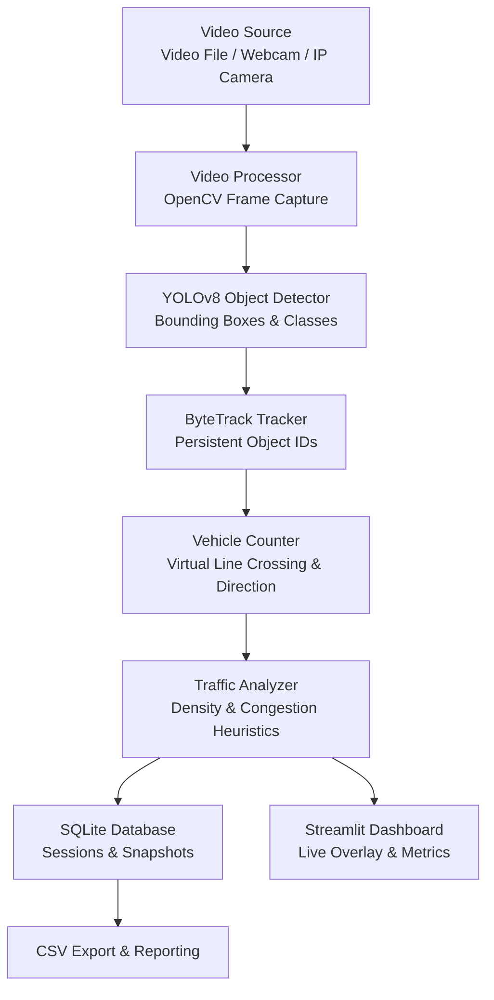

# AI-Powered Real-Time Traffic Monitoring and Vehicle Analytics System

A production-style academic computer vision application designed to detect, track, count, and analyze vehicles and pedestrians from traffic video recordings, live webcam feeds, and authorized CCTV/IP camera streams.

---

## 1. Project Introduction

Urban traffic management and monitoring systems increasingly require automated, objective, and scalable solutions to understand vehicle flow, detect congestion, and audit intersection performance. This system provides an end-to-end computer vision and analytics pipeline leveraging YOLOv8 object detection, ByteTrack multi-object tracking, bidirectional virtual line counting, and SQLite persistence, all integrated within an interactive Streamlit dashboard.

## 2. Problem Statement

Traditional traffic auditing typically relies on manual spot checks or expensive proprietary hardware loops embedded beneath asphalt. These approaches suffer from high maintenance overhead, lack granular vehicle classification, and fail to provide actionable historical analytics. This project addresses these challenges by processing video feeds in real time using edge-capable deep learning models.

## 3. Project Objectives

- **Automated Detection**: Detect vehicles (cars, buses, trucks, motorcycles) and pedestrians using pretrained YOLOv8.
- **Robust Tracking**: Maintain object identity across frames with ByteTrack to prevent duplicate counting.
- **Directional Counting**: Count objects crossing a configurable virtual line, distinguishing between inbound and outbound directions.
- **Traffic Analytics**: Compute real-time vehicle density, heuristic congestion levels, class distribution, and FPS performance.
- **Data Persistence**: Record session metrics and periodic traffic snapshots into an embedded SQLite database.
- **Dashboard & Reporting**: Provide a responsive interface with live monitoring, video processing, historical records, and CSV exports.

## 4. Key Features

- **Multi-Source Video Input**: Supports uploaded video files (`.mp4`, `.avi`, `.mov`, `.mkv`), local webcams, and authenticated RTSP/HTTP streams.
- **Configurable Detection & Tracking**: Dynamic confidence thresholds, IoU parameters, model selection, and CPU/CUDA auto-detection.
- **Bidirectional Virtual Line Counting**: Geometric orientation checks ensure vehicles are counted only once when transitioning across the reference boundary.
- **Heuristic Congestion Classification**: Categorizes traffic state (`LOW`, `MODERATE`, `HIGH`) based on active vehicles per frame and density.
- **Privacy & Security First**: URL password masking prevents credentials from leaking into UI or logs; file upload restrictions guard against path traversal.
- **Exportable Metrics**: Export session records and aggregated historical data directly to CSV.

## 5. Technology Stack

- **Language**: Python 3.12 / 3.11
- **Object Detection**: Ultralytics YOLOv8 (default: `yolov8n.pt`)
- **Object Tracking**: ByteTrack (via Ultralytics tracking engine)
- **Computer Vision**: OpenCV (`cv2`)
- **Numerical & Data Processing**: NumPy, Pandas
- **Dashboard & UI**: Streamlit
- **Visualization**: Matplotlib
- **Database**: SQLite3 (built-in Python engine)
- **Automated Testing**: Pytest

## 6. System Architecture



## 7. Folder Structure

```
traffic-monitoring-system/
├── app.py                      # Main Streamlit Dashboard Application
├── requirements.txt            # Python dependencies
├── README.md                   # Comprehensive project documentation
├── DEVELOPMENT_PROGRESS.md     # Phase-by-phase implementation log
├── .gitignore                  # Git exclusions for models, logs, databases
├── .env.example                # Example environment configuration
├── config/
│   ├── __init__.py
│   └── settings.py             # Global application configuration
├── core/
│   ├── __init__.py
│   ├── detector.py             # YOLOv8 object detection wrapper
│   ├── tracker.py              # ByteTrack tracking integration
│   ├── video_processor.py      # Video capture, stream handler, output writer
│   ├── vehicle_counter.py      # Line crossing and directional counting
│   └── traffic_analyzer.py     # Density and congestion analytics
├── database/
│   ├── __init__.py
│   ├── db_manager.py           # SQLite database manager
│   └── schema.sql              # Database schema definition
├── utils/
│   ├── __init__.py
│   ├── file_utils.py           # Safe file operations and path helpers
│   ├── video_utils.py          # Synthetic test video generator
│   ├── validation.py           # Input, file, and stream validation
│   └── logger.py               # Structured logging and credential sanitization
├── components/
│   ├── __init__.py
│   ├── sidebar.py              # Sidebar navigation and global controls
│   ├── metrics.py              # Metric cards and KPI badges
│   ├── charts.py               # Matplotlib visual analytics charts
│   └── video_panel.py          # Live video display and bounding box overlays
├── tests/
│   ├── test_detector.py        # Unit tests for YOLOv8 detection & bounding boxes
│   ├── test_video_processor.py # Unit tests for video ingestion, generators & writers
│   ├── test_tracker.py         # Unit tests for ByteTrack multi-object tracking
│   ├── test_vehicle_counter.py # Unit tests for 2D line crossing & directional logic
│   ├── test_traffic_analyzer.py# Unit tests for density, FPS & congestion heuristics
│   ├── test_database.py        # Unit tests for SQLite persistence & migrations
│   ├── test_validation.py      # Unit tests for security, URLs & file integrity
│   ├── test_dashboard.py       # Unit tests for dashboard helpers, charts & CSV exports
│   └── test_phase7_integration.py # End-to-end integration tests & error handling
├── models/                     # Pretrained YOLO weights directory (yolov8n.pt)
├── data/
│   ├── uploads/                # Temporary uploaded video files
│   ├── processed/              # Annotated output videos with bounding boxes
│   ├── samples/                # Real & synthetic traffic test videos
│   └── traffic_analytics.db    # Embedded SQLite3 analytics database
├── logs/                       # Application runtime logs
├── reports/                    # Exported CSV traffic audit reports
└── docs/
    ├── ARCHITECTURE.md         # Detailed architectural documentation
    ├── SETUP_GUIDE.md          # Setup and deployment guidelines
    └── USER_GUIDE.md           # Operational manual for end users
```

## 8. Installation Instructions (Windows PowerShell)

### Step 1: Open Windows PowerShell and navigate to the project directory
```powershell
cd d:\ai-traffic-monitoring-system
```

### Step 2: Create a virtual environment
```powershell
py -3.12 -m venv venv
```

### Step 3: Activate the virtual environment
```powershell
.\venv\Scripts\Activate.ps1
```
*(If PowerShell restricts script execution, run: `Set-ExecutionPolicy -ExecutionPolicy RemoteSigned -Scope Process`)*

### Step 4: Upgrade pip and install dependencies
```powershell
python -m pip install --upgrade pip
pip install -r requirements.txt
```

## 9. Model Weights

The system uses `yolov8n.pt` by default. When the detector runs for the first time, Ultralytics automatically downloads the official weights from GitHub if not already present in the `models/` directory.

Alternatively, download manually and place in `models/`:
- [yolov8n.pt (Nano)](https://github.com/ultralytics/assets/releases/download/v8.3.0/yolov8n.pt)

## 10. Running the Application

Launch the Streamlit web dashboard:
```powershell
streamlit run app.py
```
Open your browser at `http://localhost:8501`.

## 11. Running Automated Unit & Integration Tests

Execute the automated test suite with pytest:
```powershell
python -m pytest -q
```
Expected result: **83 passed in ~12s (100% pass rate)**.

## 12. Troubleshooting & FAQ

- **OpenCV Video Codec Errors**: Ensure OpenCV is installed with proper video encoding support. If `.mp4` encoding fails, try `.avi` with `XVID` or install OpenH264.
- **Camera Access Denied**: Verify Windows Privacy settings allow desktop applications to access your camera.
- **RTSP Connection Drop**: Network jitter can disconnect IP cameras. The application includes timeout handling and graceful reconnection attempts.

## 13. License & Academic Attribution

This project is created as a production-grade academic capstone system. Object detection models are provided under Ultralytics AGPL-3.0 / Enterprise licenses.
